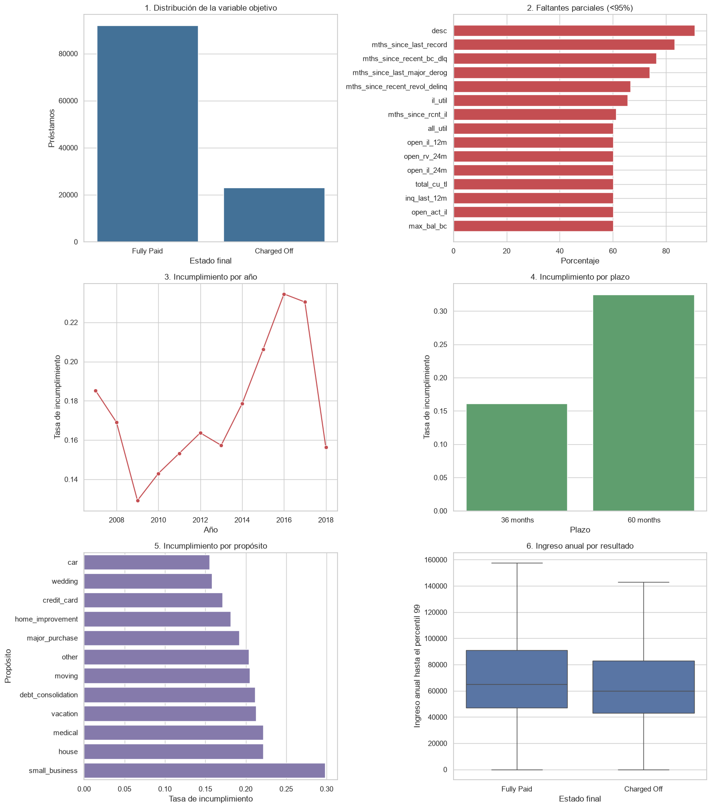
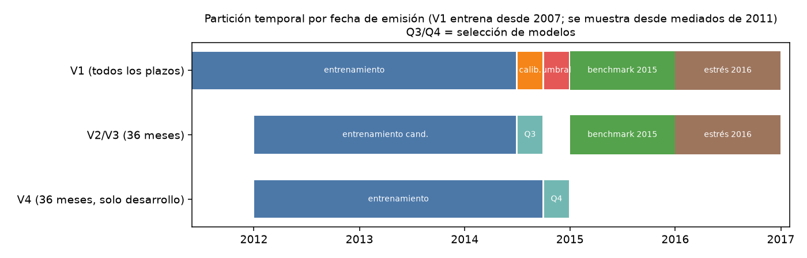
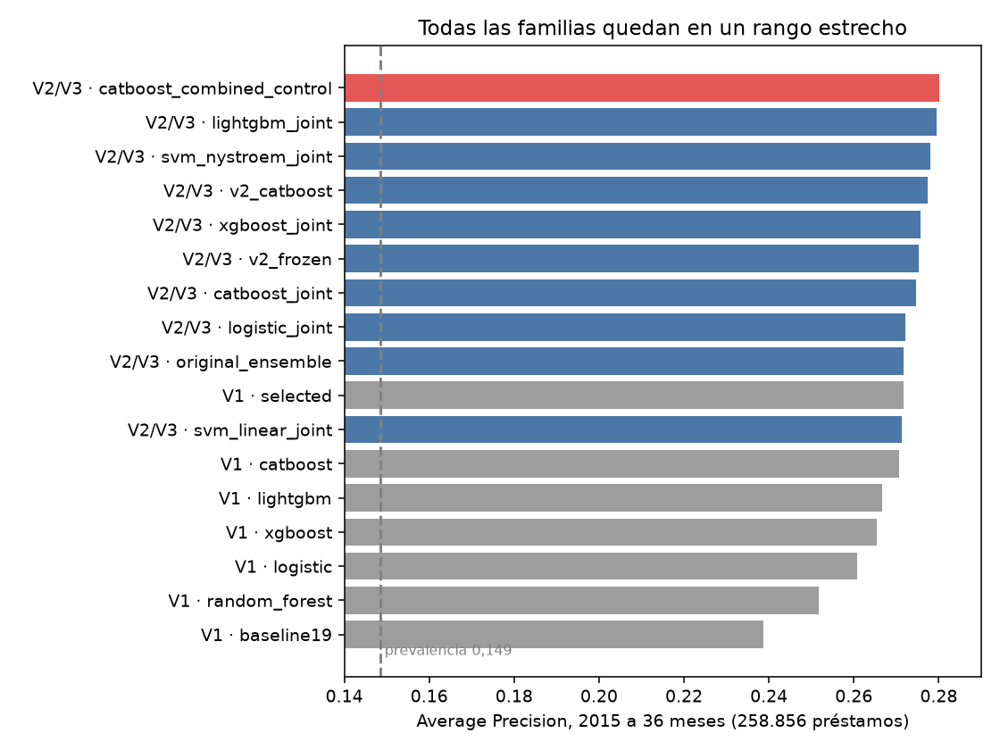
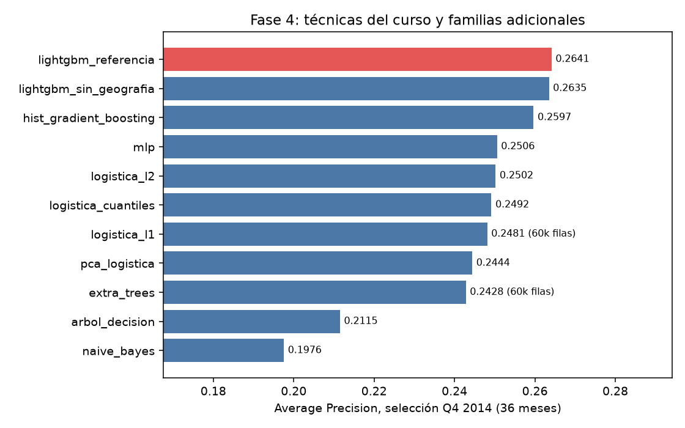
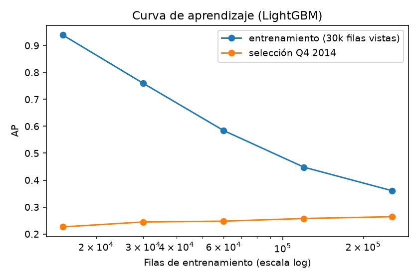
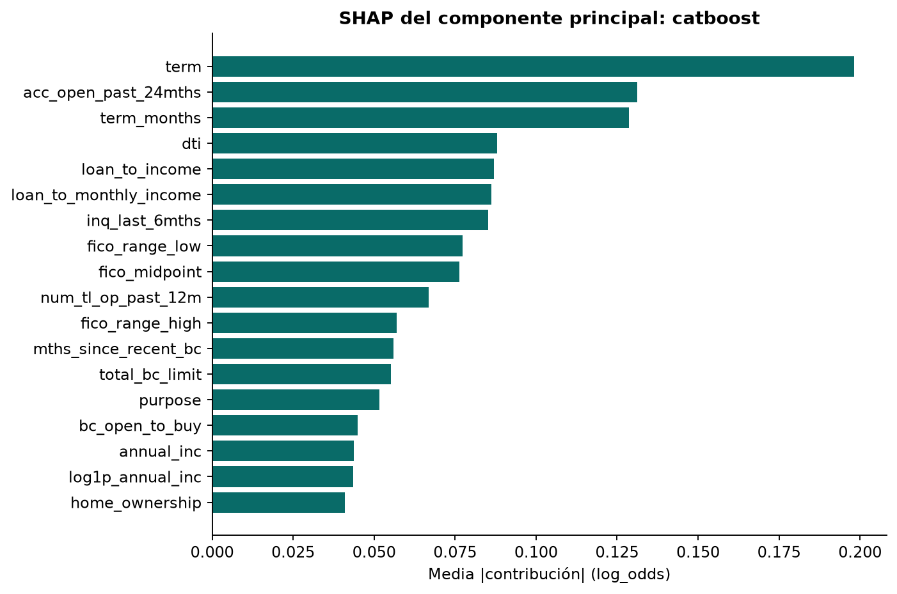
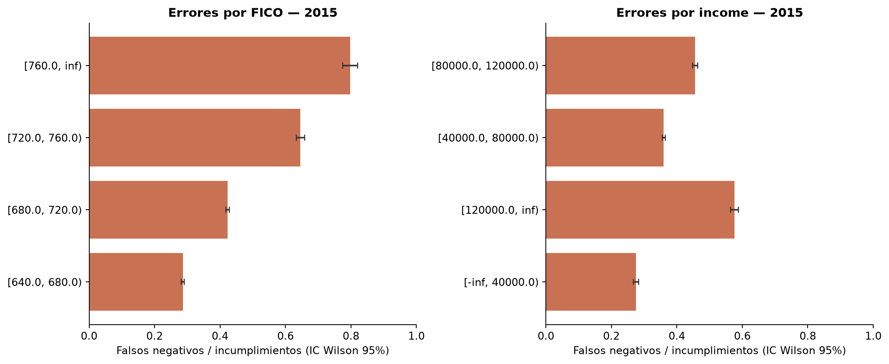

# Predicción del riesgo de incumplimiento en préstamos personales de Lending Club

**Informe final, Machine Learning, Grupo 7.**
Marco Soto Maceda · Marcelo Ferreyra · Valentino Contreras · Rayhan Matos · Leonardo Panduro

Repositorio: este proyecto. Las cifras provienen de archivos versionados en `outputs/`; cada tabla indica su fuente.

---

## 1. Resumen ejecutivo

**Problema.** Ordenar por riesgo los préstamos personales aceptados por Lending Club para estimar cuáles terminarán en `Charged Off`. Solo se usa la información disponible al originar el préstamo.

**Datos.** El archivo público de Kaggle contiene 2.260.701 préstamos (2007–2018) y 151 variables. Se modelan solo los préstamos con desenlace terminal, y se excluyen todas las variables posteriores al otorgamiento y la calificación o tasa asignadas por la plataforma.

**Validación.** La partición es temporal por fecha de emisión. El desarrollo termina en 2014, 2015 es la prueba principal y 2016 una prueba de estrés. El protocolo, la selección y el código se congelaron con hashes SHA-256 antes de abrir las pruebas. La métrica principal es la Average Precision (AP).

**Resultados.**

- **Prueba confirmatoria (V1, nunca reutilizada para decidir).** En 343.507 préstamos de 2015, un ensamble de 60% CatBoost y 40% LightGBM logra **AP 0,4164**, frente a 0,3890 de una regresión logística baseline reentrenada con los mismos datos. La mejora pareada es **+0,0274 (IC95 [+0,0252; +0,0296])** y el ROC-AUC es 0,733.
- **Modelo recomendado (V3, a 36 meses).** Un CatBoost con variables financieras adicionales y entrenamiento ampliado alcanza **AP 0,2801** en 258.856 préstamos de 2015 a 36 meses, frente a 0,2718 del ensamble V1 en las mismas filas. Ese benchmark ya se había observado, así que esta cifra se presenta como evidencia secundaria y no como una prueba independiente. Este modelo incluye como contexto el prefijo de tres dígitos del código postal y el título del empleo (`feature_mode: combined`); su aporte medido fue ≈0 (§11). La recomendación de retirar la geografía (§13) es para una versión de producción cuyo efecto no se midió.
- **Hallazgo central.** Se compararon familias y estrategias muy distintas, entre ellas logística, árboles, bosques, cuatro implementaciones de boosting, tres variantes de SVM, Naive Bayes, red neuronal y ensambles. Todas quedan en un rango estrecho: en 2015 a 36 meses, los modelos ajustados de V1 a V3 van de AP 0,252 (Random Forest) a 0,280 (CatBoost V3), y 11 de los 16 modelos de la figura 8.1 (el baseline incluido; el ensamble V1, que aparece dos veces, se cuenta una) están entre 0,271 y 0,280. Ni la búsqueda de hiperparámetros, ni más filas, ni la calificación de la propia plataforma mueven el resultado más de unas milésimas. **El límite está en la información disponible al originar el préstamo, no en el algoritmo.**

**Uso responsable.** El modelo sirve para priorizar la revisión, por ejemplo del 20% de mayor riesgo, donde captura alrededor del 39% de los incumplimientos a 36 meses. No sirve para aprobar o rechazar solicitudes de forma automática. Sus diferencias entre segmentos se discuten en §12 y §13.

---

## 2. Descripción del problema

En el préstamo entre personas, el prestamista asume la pérdida si el prestatario deja de pagar. Ordenar bien las solicitudes por riesgo permite revisar con más cuidado las de riesgo alto, establecer límites de exposición y fijar un precio coherente con el riesgo.

- **Pregunta predictiva:** ¿cuál es la probabilidad de que un préstamo personal aceptado termine en incumplimiento, usando las características del solicitante, del préstamo y de su historial crediticio registradas antes del otorgamiento?
- **Variable objetivo:** `1 = Charged Off` y `0 = Fully Paid`. Los préstamos vigentes, atrasados o en otros estados no se convierten en negativos: se excluyen, y su cobertura se reporta en §3.
- **Unidad de predicción:** un préstamo aceptado.
- **Momento de predicción:** al completar la evaluación de la solicitud y antes del desembolso.
- **Uso previsto:** priorizar la revisión o la provisión de riesgo. Se analizan dos escenarios: revisar el 20% de mayor riesgo y fijar un umbral por F1 o por un recall mínimo.

---

## 3. Descripción del dataset

| Aspecto | Detalle |
|---|---|
| Fuente | [Lending Club Loan Data, versión 3 (Kaggle)](https://www.kaggle.com/datasets/wordsforthewise/lending-club/versions/3) |
| Licencia | CC0: Public Domain, según la ficha |
| Archivo | `accepted_2007_to_2018Q4.csv.gz`, SHA-256 `55c16f75…62a2d` (`outputs/data_manifest.json`) |
| Tamaño | 2.260.701 préstamos y 151 variables; 1.345.310 con desenlace terminal |
| Muestra del avance | 115.000 préstamos terminales al azar (semilla 42) en `data/lending_club_muestra.csv.gz`. Su distribución anual coincide con la población terminal (TVD por año 0,0027) |
| Particiones del archivo completo | Desarrollo hasta 2014: 451.059 filas. Prueba 2015: 343.507. Estrés 2016: 268.096. Ninguna fila de prueba pertenece a la muestra explorada |

**Cobertura de desenlaces** (`outputs/final/maturity_coverage.csv`, figura `reports/figures/03_cobertura.png`):

| Cohorte | Préstamos emitidos | Con desenlace terminal | Cobertura |
|---|---:|---:|---:|
| 2015, 36 meses | 259.003 | 258.856 | **99,94%** |
| 2015, 60 meses | 130.054 | 84.651 | 65,09% |
| 2016, 36 meses | 303.624 | 212.482 | 69,98% |
| 2016, 60 meses | 105.784 | 55.614 | 52,57% |

**Limitaciones de muestreo:**

- **Solo hay préstamos aceptados.** No hay solicitantes rechazados, así que existe sesgo de selección.
- **Las cohortes recientes están censuradas.** En 2016 y en los préstamos a 60 meses de 2015 faltan los préstamos que aún no terminaban. Por eso la población principal de V2 y V3 es la de 36 meses, cuyo seguimiento en 2015 está casi completo.
- **Falta `member_id`.** No se pueden agrupar préstamos del mismo prestatario.

---

## 4. Limpieza y preparación de datos

Fuentes: `src/features.py`, `optimization/features.py`, `experiments/feature_contract_v3.csv` y notebook 02.

1. **Contrato explícito de variables.** Una lista blanca de 82 variables de originación: solicitud, ingreso, DTI, FICO de origen y buró al originar. Una lista negra (`FORBIDDEN`), verificada por pruebas automáticas, excluye el estado del préstamo, pagos, recuperaciones, FICO posterior, `last_credit_pull_d`, montos financiados, hardship y settlement.
2. **Exclusión de alcance.** No se usan `grade`, `sub_grade`, `int_rate` ni `installment`, porque resumen la evaluación de la propia plataforma. Como diagnóstico, añadirlas solo sube el AP en +0,004 (§10).
3. **Reglas de dominio fijas, no aprendidas:**
   - ingreso ≤ 0, FICO fuera de [300, 850], o DTI, utilización y monto negativos pasan a faltante;
   - las fechas se convierten en antigüedad crediticia en meses.
4. **Faltantes estructurales.** 17 columnas son constantes o tienen más de 95% de ausencia en los años tempranos, porque el buró amplió sus campos en 2012. Los modelos de árboles reciben el faltante tal cual; los lineales imputan con la mediana más un indicador. En V2, usar indicadores de faltantes cambió el AP de CV en −0,0011, así que no hay daño apreciable.
5. **Valores extremos.** No se recortan por percentiles en la receta principal. El recorte con transformación logarítmica (`log_clip`) se probó como receta alternativa: −0,0014 AP en V3.
6. **Variables derivadas.** Cocientes de capacidad y endeudamiento, como préstamo/ingreso, saldo/límite revolvente y cuentas recientes/totales. V3 añadió 20 relaciones financieras documentadas en `feature_contract_v3.csv`.
7. **Pipelines.** Imputación, escalado y codificación (one-hot u ordinal) se ajustan **solo con el entrenamiento** de cada corte, dentro de `Pipeline`/`ColumnTransformer` de scikit-learn.
8. **Pruebas automáticas.** Hay 29 pruebas: variables prohibidas, fechas disjuntas, etiquetas barajadas que dan AP ≈ prevalencia, calibradores válidos y rechazo de código modificado tras el congelamiento. La última ejecución, del 22/11/2026, pasó las 29 (`outputs/checks/tests_entrega_final.txt`).

---

## 5. Análisis exploratorio



*Figura 5.1. Muestra de 115.000 préstamos: objetivo, faltantes, incumplimiento por año, plazo y propósito, e ingreso por resultado (notebook 01).*

- **Desbalance:** 20,0% `Charged Off` en la muestra; 14,9% en 2015 a 36 meses.
- **El plazo es la variable más asociada al riesgo:** a 60 meses el incumplimiento casi duplica al de 36 meses.
- **Cambio temporal:** la tasa a 36 meses pasa de 12,3% (2013) a 14,9% (2015). La población también cambia (`outputs/research_v2/temporal_population_shift.csv`).
- **Propósito:** `small_business` es el de mayor riesgo; `car` y `credit_card`, los de menor.
- **Ingreso y FICO:** las distribuciones de pagadores e incumplidores se superponen mucho. Es la primera señal del techo predictivo discutido en §10.
- **Faltantes:** se agrupan por época de los campos de buró (`reports/figures/04_disponibilidad_variables.png`).

---

## 6. Estrategia de partición y validación



*Figura 6.1. Ventanas de cada fase por fecha de emisión.*

- **Por qué temporal:** el modelo se usaría con préstamos futuros. Una partición aleatoria mezcla años y sobreestima el desempeño.
- **V1** (`experiments/protocol.json`):
  - CV con dos cortes crecientes: validación en 2012 y en 2013.
  - Selección en 2014 S1 y entrenamiento final hasta junio de 2014.
  - Calibración en 2014 Q3; elección de calibración y umbral en 2014 Q4.
  - Prueba en 2015 y estrés en 2016, abiertas **una sola vez** después de congelar el modelo, el código y los hashes.
- **V2 y V3** (`protocol_v2.json`, `protocol_v3.json`):
  - Solo préstamos a 36 meses.
  - Cortes de CV en 2013 S2 y 2014 S1, y selección en 2014 Q3.
  - V3 reentrenó hasta noviembre de 2014 y calibró en diciembre.
- **V4** (`protocol_v4.json`):
  - Entrenamiento de 2012 a septiembre de 2014 y selección en Q4 2014.
  - **No abre 2015 ni 2016.**
- **Métricas:**
  - AP (`average_precision_score`, sin interpolación trapezoidal) como principal, porque la clase positiva es minoritaria.
  - ROC-AUC, Brier, log-loss, F1 y recall al 20% como secundarias.
  - Accuracy no se usa.
- **Comparaciones justas:** siempre sobre las mismas filas, con bootstrap pareado por préstamo y por mes de emisión.
- **Reutilización declarada.** 2015 y 2016 se abrieron en V1. V2 y V3 volvieron a usarlos como **benchmark retrospectivo**. Por eso la única evaluación que cumple de forma estricta "no evaluar sobre datos usados para decidir" es la de V1, y así se presenta en §10.

---

## 7. Baselines

| Baseline | Evaluación | AP | Referencia |
|---|---|---:|---|
| Sin señal (prevalencia) | 2015 todos / 2015 a 36 meses | 0,201 / 0,149 | — |
| Solo el plazo | 2015, todos los plazos | 0,273 | `research_v2/term_only_baseline.csv` |
| Logística, 19 variables (avance S1, partición aleatoria) | Validación de la muestra | 0,361 | Otra partición, no comparable |
| **Logística, 19 variables, reentrenada (baseline oficial)** | **2015, todos los plazos** | **0,389** | `outputs/final/metrics.csv` |
| Solo el rango de `int_rate` de Lending Club (diagnóstico) | 2014 Q3, 36 meses | 0,213 | `platform_score_baselines.csv` |

El modelo independiente de la calificación de la plataforma (0,245 en ese diagnóstico) supera a ordenar solo por la tasa que asignó Lending Club (0,213).

---

## 8. Modelos entrenados

**V1: cinco familias, todos los plazos, prueba en 2015** (`outputs/final/metrics.csv`):

| Modelo | AP 2015 | AP 2015, 36 meses | AP 2016 (estrés) |
|---|---:|---:|---:|
| Baseline logístico (19 variables) | 0,3890 | 0,2386 | 0,3958 |
| Regresión logística ajustada | 0,4021 | 0,2607 | 0,4064 |
| Random Forest | 0,4006 | 0,2518 | 0,4055 |
| XGBoost | 0,4115 | 0,2654 | 0,4195 |
| LightGBM | 0,4117 | 0,2666 | 0,4203 |
| CatBoost | 0,4145 | 0,2706 | 0,4233 |
| **Ensamble 60% CatBoost + 40% LightGBM (seleccionado)** | **0,4164** | **0,2718** | **0,4248** |

**V2: diagnóstico de datos y SVM (36 meses).** Se compararon nueve recetas de datos y tres estrategias SVM:

- lineal;
- RBF exacta, limitada a 12.000 filas por su costo;
- aproximación de Nyström.

Con las mismas 12.000 filas para todas las familias, la mejor SVM (Nyström, 0,234) queda por debajo de CatBoost (0,238). Se eligió un CatBoost con variables estables entrenado desde 2012.

**V3: optimización conjunta (36 meses).** Se probaron seis familias con preparación específica, relaciones financieras y variables de contexto (`emp_title`, código postal). Hubo 46 intentos de búsqueda y 39 estrategias en selección (13 individuales y 26 ensambles). **Ningún ensamble superó al mejor modelo individual.**



*Figura 8.1. AP en 2015 a 36 meses de todos los modelos de V1 a V3. Fuera del baseline de 19 variables (0,239), el rango completo es de 0,028 unidades.*

**V4: técnicas del curso (solo desarrollo, Q4 2014).** Ver §8.4.

<!-- FASE4_START -->
### 8.4 Fase 4: técnicas del curso y familias adicionales

**Protocolo** (`experiments/protocol_v4.json`, registrado antes de ejecutar):

- Préstamos a 36 meses.
- Entrenamiento desde 2012-01 hasta 2014-09, con 256.442 préstamos.
- Selección y diagnóstico en Q4 2014, con 50.020 préstamos y prevalencia del 14,5%.
- **No se abrió 2015 ni 2016.**
- Mismas 96 variables (`FeatureBuilder`) y mismas filas de selección para todos los candidatos; L1 y ExtraTrees se entrenaron con 60.000 filas por costo.
- Parámetros fijos razonables, sin búsqueda: se comparan familias, no óptimos.
- La referencia interna es LightGBM con parámetros fijos.

Resultados en `outputs/research_v4/leaderboard_q4.csv`, `paired_vs_reference.json` y `fairness_segments_top20.csv`.

| Candidato | Tema del curso | AP Q4 2014 | ROC-AUC | ΔAP vs. referencia [IC95 pareado] |
|---|---|---:|---:|---|
| **LightGBM (referencia)** | 6.6.5 Boosting | **0,2641** | 0,690 | — |
| LightGBM sin `addr_state` | 6.10.1 Sesgo algorítmico | 0,2635 | 0,689 | −0,0006 [−0,0026; +0,0013] |
| HistGradientBoosting | 6.6.5 Boosting | 0,2597 | 0,687 | −0,0045 [−0,0068; −0,0022] |
| MLP 64-32 (L2 y early stopping) | 6.7 Redes neuronales | 0,2506 | 0,677 | −0,0136 [−0,0179; −0,0088] |
| Logística L2 | 6.6.1 Regresión logística | 0,2502 | 0,679 | −0,0139 [−0,0182; −0,0092] |
| Logística con cuantiles normales | 6.4.3 Transformaciones | 0,2492 | 0,675 | −0,0150 [−0,0192; −0,0102] |
| Logística L1 (60.000 filas) | 6.3.1 Regularización L1 | 0,2481 | 0,674 | −0,0160 [−0,0207; −0,0109] |
| PCA (95% de varianza, 54 componentes) + logística | 6.8.1 PCA | 0,2444 | 0,672 | −0,0197 [−0,0240; −0,0148] |
| ExtraTrees (60.000 filas) | 6.6.5 Bagging | 0,2428 | 0,669 | −0,0213 [−0,0268; −0,0162] |
| Árbol de decisión (profundidad 6, 58 hojas) | 6.6.3 Árboles | 0,2115 | 0,633 | −0,0526 [−0,0590; −0,0463] |
| Naive Bayes gaussiano | 6.5.4 Naive Bayes | 0,1976 | 0,619 | −0,0666 [−0,0734; −0,0595] |



**Lectura:**

- **Ningún candidato supera a la referencia de V4.** V4 no compara contra V3 directamente (la referencia es LightGBM con las variables de V1); V3 se mantiene por la evidencia de §10.2.
- **El ranking confirma el patrón de V1 a V3.** El boosting está arriba, las familias lineales y la red neuronal quedan unas 0,014 por debajo, y los modelos de baja capacidad (árbol simple, Naive Bayes) muy por debajo. Naive Bayes además da probabilidades mal calibradas (Brier 0,26), porque supone independencia entre variables muy correlacionadas.
- **PCA (reducción de dimensionalidad) empeora a la logística en −0,006.** Con unas 100 variables y 256.000 filas no hay maldición de la dimensionalidad que corregir, y PCA, al no ser supervisado, puede descartar direcciones de poca varianza que sí predicen.
- **L1 reduce el modelo sin perder casi nada.** Conserva 47 de 231 coeficientes (20%) y pierde 0,002 AP frente a la logística L2, aun entrenando con la cuarta parte de las filas. Las variables retenidas coinciden con SHAP: plazo, propósito, cuentas recientes, DTI, consultas y préstamo/ingreso (`outputs/research_v4/l1_selected_features.json`).
- **Quitar `addr_state` no cuesta nada medible.** El IC95 incluye el 0, y las tasas de detección (TPR) y de falsos positivos (FPR) por segmento cambian menos de 0,02 al revisar el 20% de mayor riesgo.
- **La disparidad viene del ingreso, no de la geografía.** El FPR del quintil de ingreso más bajo es del 36,5%, frente a 5,1% en el más alto, con y sin `addr_state`. Ver §13.
- **Curva de aprendizaje** (`learning_curve.csv`): AP 0,226 (15.000 filas) → 0,245 (30.000) → 0,248 (60.000) → 0,257 (120.000) → 0,264 (256.442). Los rendimientos son decrecientes, unas +0,007 por cada duplicación al final, pero no nulos. No hay más filas maduras del mismo período para seguir creciendo.
- **Sesgo y varianza en la misma curva.** El AP sobre las filas de entrenamiento cae de 0,94 a 0,36 mientras el de selección sube. Con pocas filas el modelo sobreajusta, porque domina la varianza. Con todas, la brecha se reduce a unas 0,10 y lo que queda es sobre todo el sesgo y el ruido irreducible. Detalle en el notebook 08.



**Incidencias registradas:**

- HistGradientBoosting falló en los dos primeros intentos porque 16 columnas de buró están 100% vacías entre 2012 y 2014, y HistGB no admite columnas así. Se corrigió excluyéndolas solo para ese modelo.
- Los logs de los intentos fallidos están en `outputs/research_v4/intentos_previos/`.
<!-- FASE4_END -->

---

## 9. Búsqueda de hiperparámetros

| Fase | Método | Presupuesto | Criterio |
|---|---|---|---|
| V1 | Optuna (TPE), CV temporal de 2 cortes, hasta 80.000 filas por corte | 96 intentos: logística 10, RF 10, LightGBM 28, XGBoost 24, CatBoost 24 | AP media en CV; finalistas comparados en 2014 S1 |
| V2 | Optuna y control de presupuesto | 80 configuraciones, 9 recetas y reintentos de RBF | AP en 2014 Q3 |
| V3 | Optuna con poda y parada temprana por AP exacta | 46 intentos (36 completos, 10 podados, 0 fallidos) | AP en 2014 Q3 |
| V4 | Parámetros fijos razonables, sin búsqueda | 11 candidatos | Compara familias, no óptimos |

Archivos: `outputs/search_*.csv`, `outputs/best_*.json`, `outputs/research_v2/search_*.csv` y `outputs/research_v3/search_*.csv`.

**Lectura.** En la comparación controlada de V2, con las mismas filas y variables, ajustar hiperparámetros mejora el AP en +0,002 (CatBoost) y +0,003 (LightGBM). Se detectó que la parada temprana se hacía con Logloss o `aucpr` mientras la selección usaba AP, y V3 la alineó con AP exacta. Aun así, el ajuste fino aporta milésimas.

---

## 10. Evaluación final

### 10.1 Evaluación confirmatoria: V1, 2015, prueba no reutilizada

| Métrica (2015, todos los plazos, n = 343.507) | Baseline | Ensamble V1 |
|---|---:|---:|
| AP | 0,3890 | **0,4164** |
| ROC-AUC | — | 0,7334 |
| Brier (calibración sigmoid) | 0,1455 | 0,1418 |
| ΔAP pareado, IC95 por préstamo | — | **+0,0274 [+0,0252; +0,0296]** |
| ΔAP pareado, IC95 por bloque mensual | — | [+0,0243; +0,0302] |

**Políticas de decisión** (umbrales elegidos en 2014 Q4, `outputs/final/threshold_policies.csv`):

| Política (2015) | Umbral | % marcado | Precisión | Recall |
|---|---:|---:|---:|---:|
| Máximo F1 | 0,208 | 34,9% | 0,356 | 0,616 |
| Recall ≥ 60% en desarrollo | 0,221 | 32,1% | 0,367 | 0,585 |
| Capacidad: revisar el 20% | 0,299 | 18,4% | 0,438 | 0,401 |
| Umbral 0,5 | 0,500 | 3,1% | 0,603 | 0,094 |

El umbral de capacidad es el percentil 80 de las probabilidades de 2014 Q4: marca el 20% en desarrollo y el 18,4% en 2015. El umbral 0,5 no sirve con una prevalencia del 20%. El umbral se elige según la capacidad de revisión.

En el estrés de 2016 (prevalencia 23,3%, cohorte censurada), el ensamble obtiene AP 0,4248 frente a 0,3958 del baseline.

### 10.2 Modelo recomendado: V3, 36 meses, benchmark reutilizado

Las mismas 258.856 filas de 2015 a 36 meses (`outputs/research_v3/benchmark_metrics.csv`):

| Modelo | AP | ROC-AUC | Brier | Recall al 20% |
|---|---:|---:|---:|---:|
| Ensamble V1 | 0,2718 | 0,6920 | 0,1190 | 38,2% |
| CatBoost V2 | 0,2752 | 0,6951 | 0,1188 | 38,7% |
| **CatBoost V3** | **0,2801** | **0,6983** | **0,1184** | **39,1%** |

- **Frente a V2:** +0,0049 AP, con IC95 pareado [+0,0038; +0,0062]. La mejora es positiva en los cuatro trimestres de 2015 y también en 2016 (0,3560 frente a 0,3510).
- **En los cortes de desarrollo anteriores:** V3 queda por debajo de V2 en ambos (−0,0007 y −0,0026). La mejora no es uniforme en el tiempo.

### 10.3 Por qué decimos que hay un techo

1. **Las familias empatan.** Los modelos ajustados de V1 a V3 quedan entre 0,252 y 0,280 de AP en 2015 a 36 meses, y los boosting entre 0,265 y 0,280. En V4, sobre Q4 2014, ocurre lo mismo (§8.4).
2. **Los hiperparámetros aportan milésimas:** +0,002 y +0,003.
3. **Más datos rinden cada vez menos.** La curva de aprendizaje de V2 pasa de AP 0,2435 con 60.000 filas a 0,2501 con 215.847; la de V4 sube unas +0,007 por cada duplicación al final. Ya se usan todas las filas maduras del período, y entrenar con historia más antigua empeora: −0,0036 al entrenar desde 2013 frente a desde 2012.
4. **Ni la evaluación de la plataforma ayuda.** Añadir `grade`, `sub_grade` e `int_rate` solo sube el AP en +0,004 (0,2450 → 0,2488).
5. **El riesgo depende del futuro.** El incumplimiento depende de hechos posteriores al otorgamiento, como desempleo o enfermedad, que no están en la solicitud. Es el error irreducible del dilema sesgo-varianza.

---

## 11. Interpretación



*Figura 11.1. Contribución SHAP media absoluta (CatBoost, V1).*

- **Variables más influyentes:**
  - plazo (`term`);
  - cuentas abiertas en los últimos 24 meses;
  - DTI;
  - préstamo/ingreso;
  - consultas de crédito en 6 meses;
  - FICO.
- **Permutación por grupos en V3** (`outputs/research_v3/interpretability.csv`, caída de AP al permutar):
  - cuentas de buró: 0,046;
  - crédito revolvente: 0,039;
  - monto: 0,038;
  - ingreso: 0,018;
  - FICO: 0,016;
  - historial: 0,013;
  - vivienda y propósito: 0,011;
  - DTI: 0,011.
- **Variables que no aportan:** `emp_title`, `zip_code` y `emp_length` (≈0 o negativo). En la Fase 4, quitar `addr_state` cuesta −0,0006 AP (§8.4).
- **Coherencia:** las direcciones coinciden con la intuición crediticia (más endeudamiento y más búsqueda reciente de crédito implican más riesgo), pero son asociaciones, no efectos causales.
- Hay explicaciones locales de casos verdaderos y falsos positivos y negativos en `reports/figures/12_casos_locales.png` y en el notebook 04.

---

## 12. Análisis de errores



*Figura 12.1. Errores por segmento en 2015, con el ensamble V1 y el umbral de máximo F1 (`outputs/analysis/segment_errors.csv`).*

| Segmento (2015) | n | Prevalencia | AP | Recall | FPR |
|---|---:|---:|---:|---:|---:|
| FICO [640, 680) | 127.847 | 25,1% | 0,454 | 0,714 | **0,423** |
| FICO ≥ 760 | 15.812 | 7,4% | 0,242 | **0,202** | 0,033 |
| Ingreso < 40.000 | 54.630 | 23,2% | 0,420 | 0,725 | **0,463** |
| Ingreso ≥ 120.000 | 43.458 | 15,3% | 0,350 | 0,424 | 0,141 |
| 60 meses | 84.651 | 36,3% | 0,532 | 0,897 | **0,724** |
| 36 meses | 258.856 | 14,9% | 0,272 | 0,391 | 0,173 |
| `small_business` | 2.826 | 28,1% | 0,475 | 0,787 | 0,552 |

**Casos problemáticos:**

- **Falsos positivos concentrados en perfiles de menor ingreso, FICO bajo y plazo largo.** Con un umbral único, a esos solicitantes se les marca mucho más aunque paguen: el FPR es de 42–72%.
- **Falsos negativos en FICO alto.** El modelo detecta solo el 20% de los incumplimientos de FICO ≥ 760. Son incumplimientos "sorpresa" que la información de origen no anticipa.
- **Calibración en el tiempo.** Las probabilidades se calibraron con 2014. Cuando la prevalencia sube, el modelo **subestima** el riesgo medio: predice 18,8% frente a 20,1% observado en 2015, y 18,0% frente a 23,3% en 2016 (`outputs/analysis/reliability.csv`, `reports/figures/10_calibracion_v1.png`).
- **Robustez ante faltantes.** El estrés con faltantes (`outputs/analysis/missing_input_stress.csv`) muestra una degradación gradual, no un colapso.

---

## 13. Riesgos éticos, sesgos y limitaciones

- **Sesgo de selección:** solo hay préstamos aceptados. El modelo no sabe nada de los rechazados (no hay *reject inference*) y no debe usarse para decidir sobre toda la población solicitante.
- **Proxies de atributos protegidos.** No hay raza, sexo ni edad, pero el estado (`addr_state`), el código postal, el ingreso y la vivienda pueden actuar como proxies.
  - El código postal no se usó en V1. El modelo V3 recomendado sí incluye como contexto el prefijo de tres dígitos del código postal y el título del empleo (`feature_mode: combined`). Su aporte medido fue ≈0: la permutación de `zip_code` y `emp_title` cambia el AP en +0,0004 y −0,0002 (`outputs/research_v3/interpretability.csv`).
  - En la Fase 4, el modelo LightGBM sin `addr_state` pierde solo −0,0006 AP y deja tasas de detección y de falsos positivos casi idénticas por segmento (§8.4). **Recomendamos retirar las variables geográficas en una versión de producción**, porque el costo predictivo observado es despreciable y se reduce el riesgo de discriminación geográfica (*redlining*). Ese efecto no se midió para el modelo V3: la Fase 4 solo quitó `addr_state` y no probó retirar el prefijo del código postal ni el título del empleo.
  - Sin atributos protegidos, ninguna métrica por segmento puede certificar que el modelo sea equitativo.
- **Impacto desigual de los errores.** Los falsos positivos se concentran en ingresos bajos y FICO bajo (§12). En la Fase 4, al revisar el 20% de mayor riesgo, el FPR del quintil de ingreso más bajo es 36,5% y el del más alto 5,1%. Parte de la diferencia refleja una prevalencia real distinta, pero implica que pagadores de bajo ingreso serían revisados con mucha más frecuencia. Un uso automático de rechazo amplificaría la exclusión financiera. **Uso recomendado:** priorizar la revisión humana, no rechazar de forma automática.
- **Cambio temporal y censura.** La prevalencia y la población cambian entre años, y las cohortes recientes están incompletas. El modelo debe recalibrarse y monitorearse.
- **Evaluación retrospectiva.** No se conoce cuándo estuvo disponible cada etiqueta, así que no es un backtest de producción.
- **Reutilización del benchmark.** Las mejoras de V2 y V3 se midieron en 2015 después de haberlo observado en V1. Solo V1 es confirmatoria.
- **Alcance de V4.** V4 no compara contra V3 directamente: su referencia es LightGBM con las variables de V1 y no abre 2015 ni 2016. V3 se mantiene como modelo recomendado por la evidencia de §10.2, no por V4.
- **Transportabilidad.** Los resultados corresponden a Lending Club en EE. UU. entre 2012 y 2016. No se extrapolan a otras entidades, países ni ciclos económicos.
- **No causalidad.** Las explicaciones describen asociaciones del modelo, no efectos de intervenir sobre una variable.

---

## 14. Trabajo futuro

| Línea | Motivo | Estado |
|---|---|---|
| Variables macroeconómicas por estado y mes (desempleo, precios de vivienda) con rezago de publicación | Es la información que falta: el entorno posterior al otorgamiento | No ejecutado: requiere series externas con fecha de disponibilidad |
| Cohorte madura nueva (actualización del snapshot) | Única forma de tener otra prueba realmente independiente | Fuera del alcance de los datos |
| *Reject inference* con `rejected_2007_to_2018Q4` | Corregir el sesgo de selección | No ejecutado |
| Política de umbral basada en costos (pérdida esperada frente a margen) | Convierte el AP en valor de negocio | Solo escenarios de sensibilidad |
| Recalibración periódica y monitoreo de drift | La prevalencia cambia entre años | Recomendado |
| Restricciones monótonas, EBM, AutoGluon | Más interpretabilidad o control con AutoML | No ejecutado por tiempo |
| TabNet, FT-Transformer | Familias de deep learning tabular | No ejecutado: requieren PyTorch y GPU; la literatura reporta que no superan al boosting en tablas de este tamaño |
| SMOTE / LDA | — | Descartados por diseño: SMOTE distorsiona la calibración y no mejora el ordenamiento; LDA con dos clases equivale a otro clasificador lineal |
| Stacking con meta-modelo | — | Los 26 ensambles de V3 no superaron al mejor individual |

---

## 15. Instrucciones de reproducción

Ver el [README](../README.md). En resumen:

```bash
python -m venv .venv && source .venv/bin/activate
pip install -r requirements-lock.txt
python -m unittest discover -s tests                  # 29 pruebas
python -m src.pipeline --mode sample                  # demo con la muestra, < 1 min
# Con data/accepted_2007_to_2018Q4.csv.gz (Kaggle v3):
python -m src.pipeline --mode full --output outputs/reproduction   # V1 + Fase 4 (horas)
python -m fase4.experiment --output outputs/research_v4             # solo Fase 4 (~15 min)
python scripts/build_reports.py                       # outputs/metrics.json y reports/figures/
```

- **Semillas y versiones:** semilla 42 en todo el proyecto; versiones exactas en `requirements-lock.txt`.
- **Comandos de V2 y V3:** en `docs/historial_de_fases.md`.
- **Artefactos fuera de Git:** los modelos y las predicciones individuales se regeneran localmente.
- **Demo con la muestra:** entrena con unas 20.000 filas y sus cifras **no reproducen** las publicadas. En la ejecución registrada, CatBoost ganó en la selección de 2014, pero en 2015 obtuvo AP 0,377 frente a 0,380 de la logística. Ilustra que con pocos datos la selección es ruidosa.
