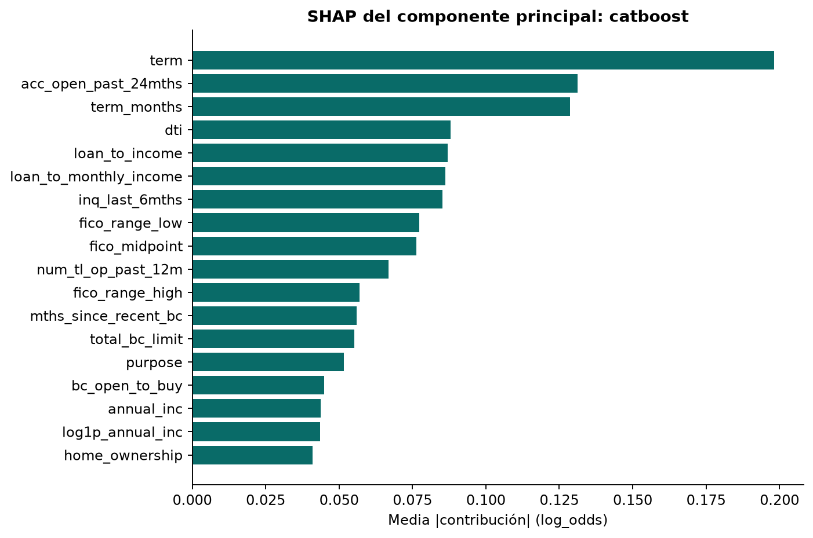

# Predicción del riesgo de incumplimiento en Lending Club

**Grupo 7.** Marco Soto Maceda · Marcelo Ferreyra · Valentino Contreras · Rayhan Matos · Leonardo Panduro

Machine Learning, entrega final

<!-- Exportar a PDF: npx @marp-team/marp-cli reports/presentacion.md --pdf --allow-local-files -->

---

## 1. Problema

- ¿Qué préstamos personales aceptados terminarán en **Charged Off**?
- Unidad: un préstamo. Momento: al originar, **antes del desembolso**.
- Uso: **priorizar la revisión** del riesgo alto, no rechazar automáticamente.
- Métrica principal: **Average Precision (AP)**; la clase positiva es minoritaria (15–20%).

---

## 2. Datos

- Kaggle *Lending Club Loan Data* v3 (CC0): **2,26 millones de préstamos y 151 variables**, 2007–2018.
- Solo desenlaces terminales; los vigentes se excluyen y su cobertura se reporta (2015 a 36 meses: 99,9%).
- **Control de leakage:** lista blanca de 82 variables de originación; se excluyen pagos, recuperaciones, FICO posterior y la nota/tasa de Lending Club.
- 29 pruebas automáticas, incluida la de etiquetas barajadas.

---

## 3. Validación temporal

- Desarrollo ≤ 2014 · **prueba 2015** · estrés 2016.
- Protocolo, modelo y código **congelados con hashes** antes de abrir la prueba.
- V1 es la única prueba no reutilizada; V2 y V3 se declaran benchmark reutilizado.

---

## 4. Modelos comparados

- Baselines: prevalencia, solo plazo y **logística de 19 variables**.
- V1: logística, Random Forest, XGBoost, LightGBM, CatBoost y ensamble; 96 intentos de Optuna.
- V2: recetas de datos y **SVM** lineal, RBF y Nyström.
- V3: relaciones financieras, contexto, 46 intentos y 26 ensambles.
- V4 (técnicas del curso): L1, PCA, Naive Bayes, árbol, ExtraTrees, MLP, HistGB y modelo sin geografía.

---

## 5. Resultado confirmatorio (2015, n = 343.507)

| | AP | ROC-AUC |
|---|---:|---:|
| Baseline logístico | 0,389 | — |
| **Ensamble CatBoost + LightGBM** | **0,416** | **0,733** |

- Mejora **+0,027 AP**, IC95 [+0,025; +0,030].
- Revisando el 20% de mayor riesgo: precisión 44%, recall 40%.
- Modelo recomendado a 36 meses (CatBoost V3): AP 0,280 frente a 0,272 del ensamble V1, sobre un benchmark reutilizado.

---

## 6. El hallazgo: el límite está en la información

- Las familias empatan; los hiperparámetros aportan +0,002 a +0,003.
- Más filas: rendimientos decrecientes. La nota de LC solo suma +0,004.
- El incumplimiento depende de hechos **posteriores** (empleo, salud): error irreducible.

---

## 7. ¿Qué mueve el riesgo?

- Plazo, cuentas abiertas recientemente, DTI, préstamo/ingreso, consultas recientes y FICO.
- `emp_title`, código postal y antigüedad laboral: aporte ≈ 0.

---

## 8. Errores y sesgos

- Falsos positivos concentrados en **ingreso < 40k (FPR 46%)**, FICO 640–680 (42%) y 60 meses (72%).
- Falsos negativos en FICO ≥ 760: solo detecta el 20%.
- Calibración: subestima el riesgo cuando la prevalencia sube (2016: 18,0% predicho, 23,3% observado).
- Quitar `addr_state` cuesta solo −0,0006 AP: **recomendamos retirar la geografía** (proxy de redlining).
- Solo préstamos aceptados (sesgo de selección) y sin atributos protegidos: no se puede certificar equidad.

---

## 9. Conclusiones y trabajo futuro

- Modelo útil para **ordenar y priorizar** (+0,027 AP confirmado), no para decidir solo.
- Mejorar requiere **más información, no otro algoritmo**: variables macro por estado con rezago, *reject inference* y una cohorte madura nueva.
- Recalibrar y monitorear el drift periódicamente.
- Reproducible: `python -m src.pipeline --mode sample` (demo de 1 minuto) o `--mode full`.

**Gracias.**
