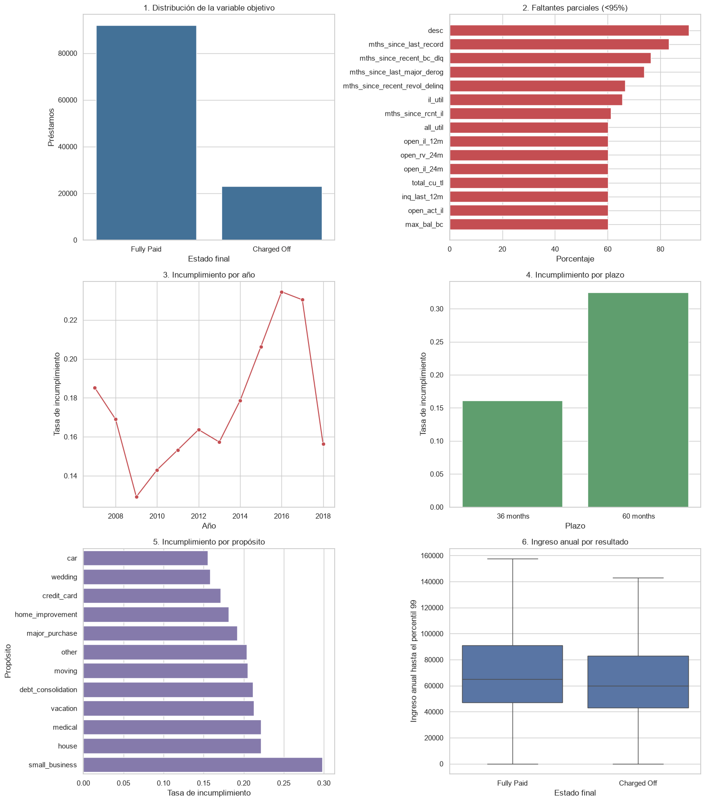
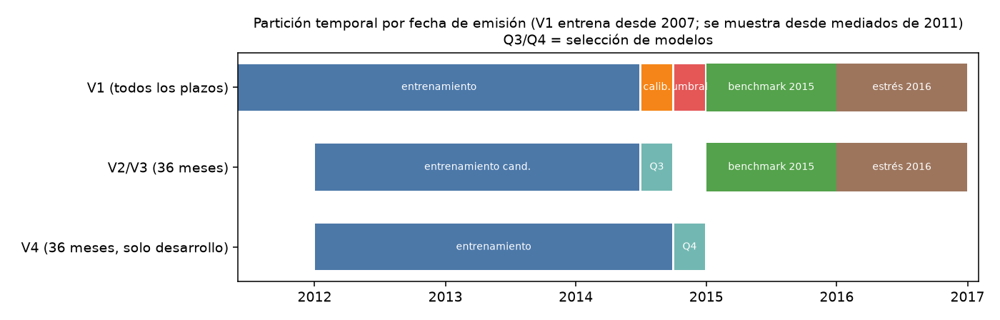
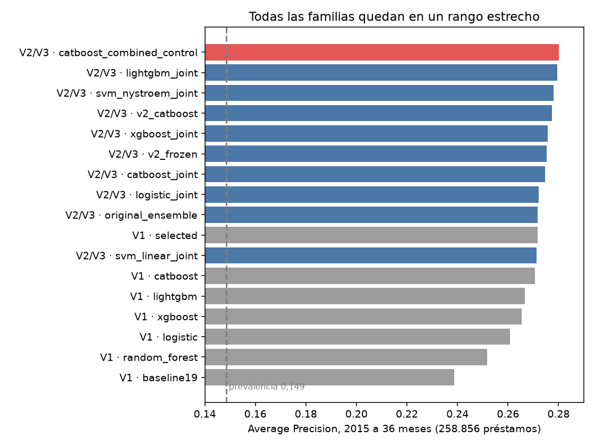
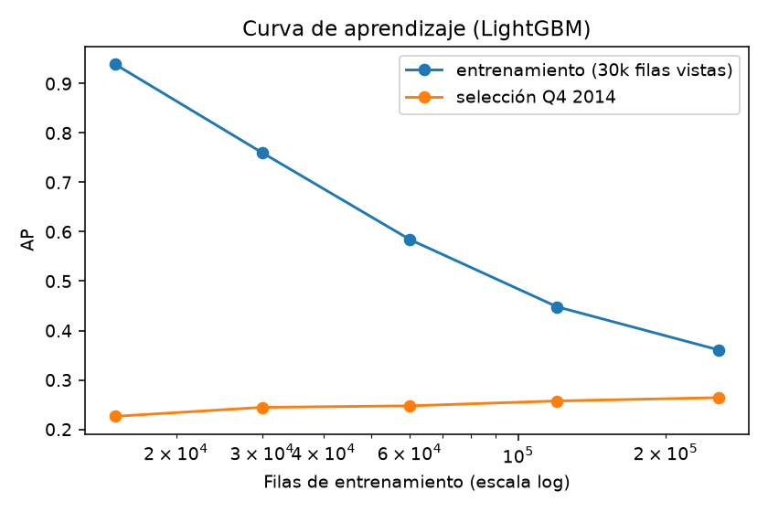
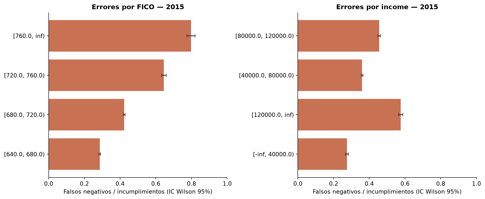

# Predicción del riesgo de incumplimiento en Lending Club

**Grupo 7.** Marco Soto Maceda · Marcelo Ferreyra · Valentino Contreras · Rayhan Matos · Leonardo Panduro

Machine Learning · Entrega Final

<!-- Exportar a PDF: npx @marp-team/marp-cli reports/presentacion.md --pdf --allow-local-files -->

---

## 1. Problema y formulación predictiva

- **Pregunta predictiva:** ¿Cuál es la probabilidad de que un préstamo personal aceptado termine en incumplimiento (`Charged Off` = 1 vs. `Fully Paid` = 0)?
- **Unidad y momento:** Un préstamo individual, evaluado **al originar y antes del desembolso**.
- **Métrica principal:** **Average Precision (AP / PR-AUC)** calculada con `average_precision_score` exacto, idónea para clases desbalanceadas (prevalencia 15–20%). Métrica secundaria: ROC-AUC.
- **Caso de negocio:** **Priorizar la revisión humana** y provisiones de riesgo del 20% más riesgoso; **no** rechazar automáticamente solicitudes.

---

## 2. Datos, cobertura y control de leakage

- **Fuente:** Kaggle *Lending Club Loan Data v3* (CC0): **2,26 millones de préstamos y 151 variables** (2007–2018).
- **Muestra reproducible:** 115.000 préstamos resueltos incluidos en el repositorio (semilla 42).
- **Cobertura terminal:** En préstamos a 36 meses de 2015 la maduración es **99,94%**; a 60 meses solo 65,09% (evitamos sesgo por censura).
- **Control estricto de leakage:**
  - Lista blanca de 82 variables disponibles al momento de originación.
  - Lista negra (`FORBIDDEN`) excluye pagos, recuperaciones, FICO posterior y calificación de Lending Club (`grade`, `sub_grade`, `int_rate`).
  - Imputación, estandarización y encoders se ajustan **únicamente en entrenamiento**.
  - **29 pruebas automatizadas** de integridad y verificación de etiquetas barajadas.

---

## 3. Protocolo de validación temporal

- **Partición temporal estricta:** Simula despliegue real en producción.
  - **Desarrollo:** Préstamos emitidos hasta 2014 (451.059 filas).
  - **Prueba confirmatoria (2015):** 343.507 préstamos abiertos **una sola vez**.
  - **Estrés temporal (2016):** 268.096 préstamos (cohorte censurada).
- **Congelamiento con hashes SHA-256:** Código, pesos, umbrales y calibradores quedaron bloqueados antes de abrir las etiquetas de 2015.
- **Transparencia metodológica:** V1 es la única prueba confirmatoria independiente; V2 y V3 se declaran formalmente como benchmarks retrospectivos reutilizados.

---

## 4. Resultado confirmatorio (Prueba 2015, n = 343.507)

| Modelo | AP 2015 | ROC-AUC | Brier | Estado |
|---|---:|---:|---:|:---:|
| Baseline logístico (19 variables) | 0,3890 | 0,7111 | 0,1455 | Reentrenado |
| Random Forest | 0,4006 | 0,7242 | 0,1427 | Congelado |
| XGBoost | 0,4115 | 0,7301 | 0,1420 | Congelado |
| LightGBM | 0,4117 | 0,7312 | 0,1420 | Congelado |
| CatBoost | 0,4145 | 0,7320 | 0,1421 | Congelado |
| **Ensamble 60% CatBoost + 40% LightGBM** | **0,4164** | **0,7334** | **0,1418** | **Ganador V1** |

- **Mejora pareada confirmada:** **+0,0274 AP**, con IC95 bootstrap [+0,0252; +0,0296].
- **Política de capacidad (marcar el ~18% de mayor riesgo):** Precisión 43,8% y Recall 40,1% (el umbral fijo 0,5 fracasa al detectar solo 9,4%).
- **Calibración:** Calibrador sigmoide ajustado en 2014 Q3 estabiliza probabilidades operativas.

---

## 5. Modelo recomendado a 36 meses y techo predictivo

- **Benchmark maduro 2015 a 36 meses (n = 258.856):**
  - Ensamble V1: AP 0,2718 | ROC-AUC 0,6920.
  - **CatBoost V3 (recomendado):** **AP 0,2801** | ROC-AUC 0,6983 (+0,0049 AP pareado [0,0038; 0,0062]).
- **¿Por qué decimos que hay un techo en la información?**
  1. **Empate de familias:** Los modelos ajustados de V1 a V3 caen en un rango estrecho de solo 0,028 de AP.
  2. **Hiperparámetros:** 96 intentos de Optuna solo aportaron +0,002 a +0,003 AP.
  3. **Ensambles:** Ninguno de los 26 ensambles de V3 superó al CatBoost individual.
  4. **Nota de Lending Club:** Añadir `grade` e `int_rate` solo suma +0,004 AP.
- **Conclusión:** **El límite está en la información de originación, no en el algoritmo.**

---

## 6. Fase 4: Técnicas del curso y análisis sesgo-varianza

| Candidato / Técnica | Tema del curso | AP Q4 2014 | ΔAP vs. Ref. [IC95] |
|---|---|---:|---|
| **LightGBM (Referencia)** | Boosting | **0,2641** | — |
| LightGBM sin `addr_state` | Sesgo algorítmico | 0,2635 | −0,0006 [−0,0026; +0,0013] |
| HistGradientBoosting | Boosting | 0,2597 | −0,0045 [−0,0068; −0,0022] |
| Red Neuronal MLP (64-32) | Redes neuronales | 0,2506 | −0,0136 [−0,0179; −0,0088] |
| Logística L2 | Regresión logística | 0,2502 | −0,0139 [−0,0182; −0,0092] |
| Logística Regularizada L1 | Regularización L1 | 0,2481 | −0,0160 [−0,0207; −0,0109] |
| PCA (95% var) + Logística | Reducción PCA | 0,2444 | −0,0197 [−0,0240; −0,0148] |
| Naive Bayes Gaussiano | Naive Bayes | 0,1976 | −0,0666 [−0,0734; −0,0595] |

- **L1 retiene 47 de 231 coeficientes (20%)** con caída despreciable (-0,002 vs L2).
- **PCA empeora (-0,006):** descarta direcciones de baja varianza que sí predicen.
- **Naive Bayes colapsa:** correlaciones de buró violan el supuesto de independencia.
- **Curva de aprendizaje:** Brecha train/val cae de 0,71 a 0,10. El residuo es sesgo y ruido irreducible.

---

## 7. ¿Qué factores determinan el riesgo?

- **Variables con mayor impacto predictivo (SHAP y permutación):**
  - **Plazo (`term`):** 60 meses duplica el riesgo frente a 36 meses.
  - **Búsqueda reciente de crédito:** Cuentas abiertas en 24 meses (`acc_open_past_24mths`) y consultas en 6 meses (`inq_last_6mths`).
  - **Capacidad y apalancamiento:** DTI, préstamo/ingreso y saldo revolvente.
  - **Solvencia previa:** Puntaje FICO de origen.
- **Variables sin aporte predictivo medible:** Título de empleo (`emp_title`), antigüedad laboral (`emp_length`) y código postal (`zip_code`) (aporte $\approx 0$).
- **Interpretación local:** Explicación individual de falsos positivos y negativos en el notebook 04.

---

## 8. Análisis de errores, calibración y consideraciones éticas

- **Distribución de errores:**
  - **Falsos positivos (FPR) concentrados:** Ingresos < 40k (46,3%), FICO 640–680 (42,3%) y plazo 60m (72,4%).
  - **Falsos negativos:** En FICO $\ge 760$, el modelo solo detecta el 20,2% de los defaults (eventos sobrevenidos de salud o desempleo).
- **Desviación de calibración:** En 2016 la prevalencia subió al 23,3%, pero el modelo predijo 18,0% medio (subestimación por drift temporal). Requiere recalibración periódica.
- **Mitigación de sesgo geográfico (*redlining*):**
  - Retirar `addr_state` solo cuesta **−0,0006 AP** (el IC95 incluye el cero).
  - **Recomendación de producción:** Retirar variables geográficas para mitigar discriminación indirecta sin costo predictivo apreciable.
  - Sin atributos protegidos reales (raza, género), no es posible certificar paridad de impacto.

---

## 9. Conclusiones, trabajo futuro y reproducibilidad

- **Conclusiones principales:**
  1. El modelo es efectivo para **ordenar y priorizar revisiones** (+0,0274 AP confirmada), pero no para rechazos automáticos desatendidos.
  2. Superar este rendimiento requiere **más información** (variables macroeconómicas rezagadas, *reject inference*), no más capas de boosting.
- **Trabajo futuro:** Incorporar tasas de desempleo estatal mensuales, modelar solicitantes rechazados y políticas basadas en costo/beneficio económico.
- **Reproducibilidad garantizada:**
  - Demo rápida (< 1 min, sin descargas): `python -m src.pipeline --mode sample`
  - Reproducción completa (Kaggle v3): `python -m src.pipeline --mode full`
  - 29 pruebas automatizadas: `python -m unittest discover -s tests`
  - Guía completa de los 8 notebooks en `notebooks/README.md`.

---

# ¡Gracias!

**Preguntas y discusión**  
Grupo 7 · Machine Learning
